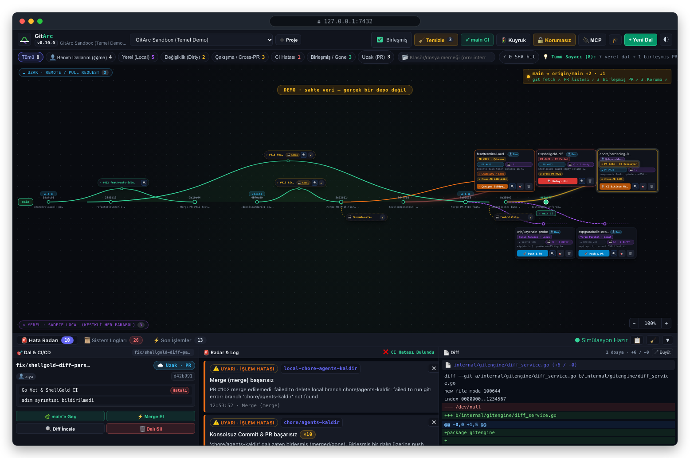
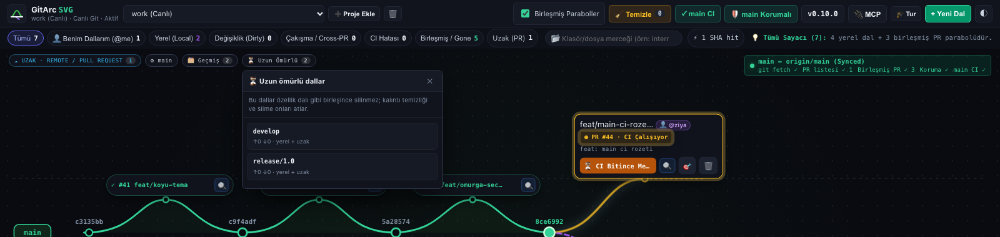
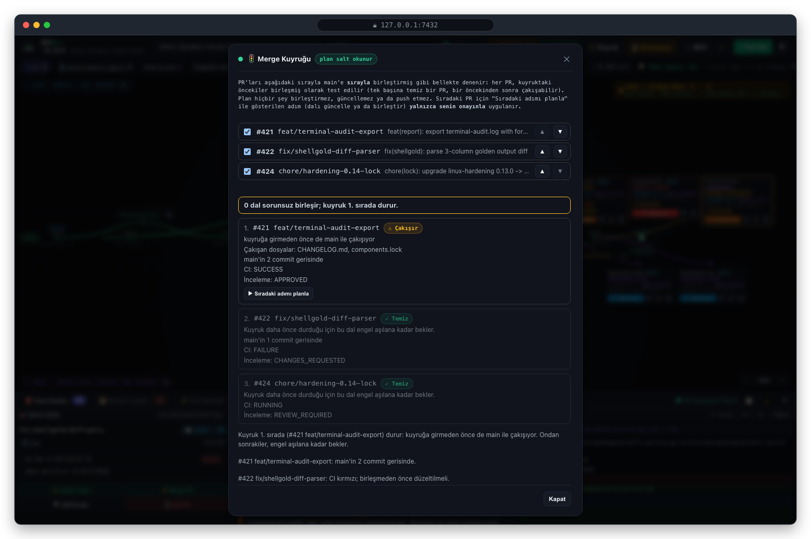
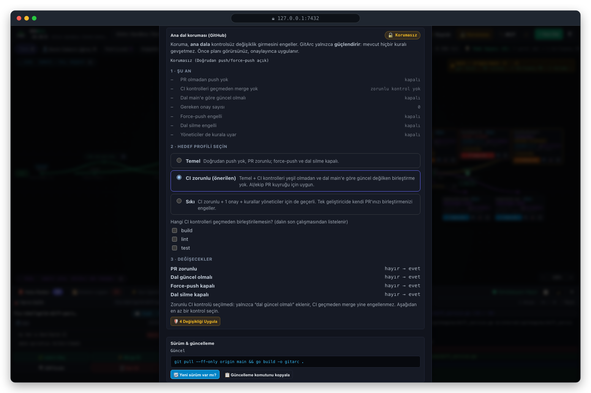
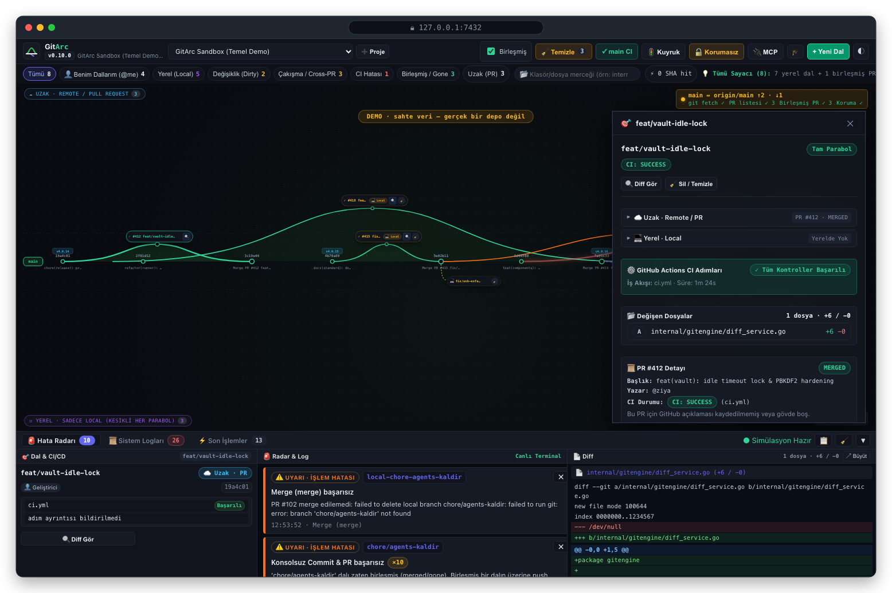
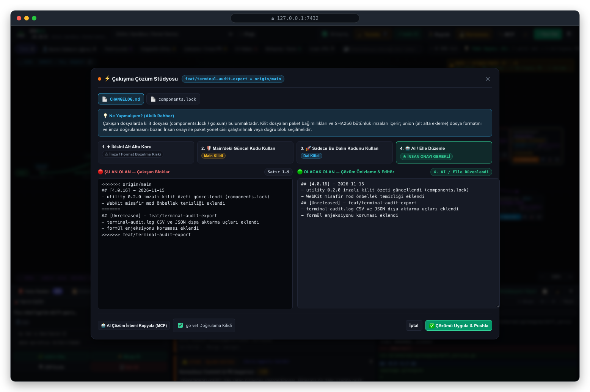
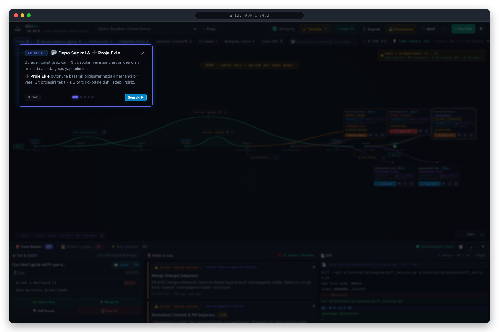
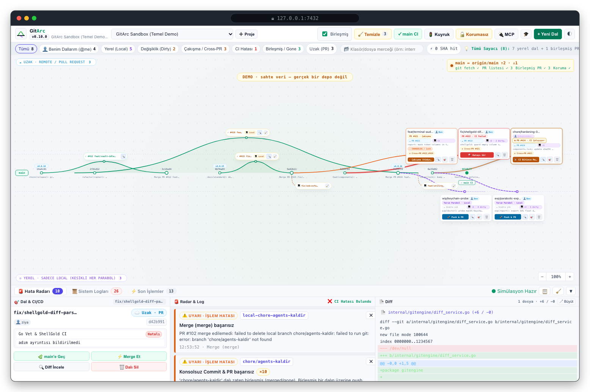
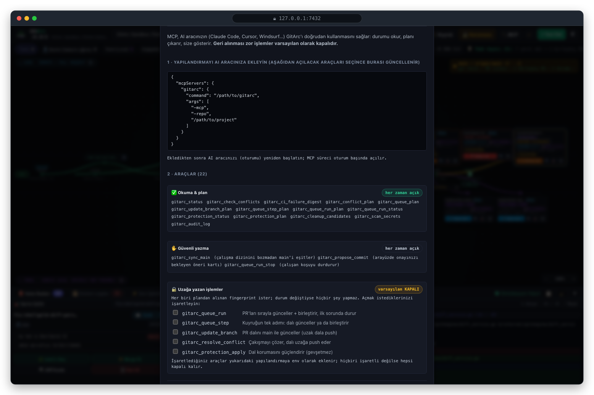

# GitArc — Parabolik Git & PR Yaşam Döngüsü Kokpiti

[](https://github.com/syhgorath/gitarc/actions/workflows/ci.yml)
[](https://github.com/syhgorath/gitarc/releases/latest)
[](https://github.com/syhgorath/gitarc/stargazers)
[](https://syhgorath.github.io/gitarc/)

**GitArc**, düz `git log` ağaçları yerine Git ve GitHub yaşam döngüsünü **parabolik ray topolojisiyle** gösteren, sıfır bağımlılıklı bir yerel kokpittir. Yerel dallarınızı (`HEAD`, uncommitted dosyalar, `origin` farkları) ile GitHub Remote, Pull Request, Review ve GitHub Actions CI durumlarını tek bir SVG tuvalinde birleştirir. [KeyLab (`sshpocket`)](https://github.com/syhgorath/keylab) tasarım ve güvenlik DNA'sını paylaşan bağımsız bir kardeş projedir.



## Parabolik metafor

| Bölge | Anlamı |
| :--- | :--- |
| **Merkez ray (`main`)** | Commit düğümleri, etiketler ve `origin/main ↑ / ↓` senkron farkı |
| **Uzak (üst yarı-küre)** | Uzak dala pushlanmış, açık Pull Request ve CI durumu taşıyan dallar |
| **Yerel (alt yarı-küre)** | Henüz pushlanmamış yerel dallar ve kirli çalışma ağacı (`wip/working-tree`), kesikli mor yay |
| **Kapalı yeşil yay** | `main`'e geri dönen, birleşmiş dallar |
| **Renkli yaylar** | Kırmızı: CI hatası · Turuncu: çakışma · Sarı nabız: CI çalışıyor |
| **Kesik iz** | Yerel dal pushlanıp PR olunca eski konumundan uzak konumuna giden kısa kesik çizgi ("uzağa gidiyor") |

Sol üst köşede `UZAK` ve sol alt köşede `YEREL` etiketleri süzgeç görevi görür; yanlarında omurga dalı seçici (`⚙ main`), `🗂 Geçmiş` ve `⏳ Uzun Ömürlü` çipleri durur.



Dallar kalabalıklaştıkça şerit sayısı sınırsız artar, omurga düğümleri açılır ve dış yaylar iç yayları kapsayacak biçimde çizilir.

## Öne çıkanlar

### Merge kuyruğu: korumalı repoda birden çok PR'ı tek onayla birleştirme
Korumalı `main`'de ("dal güncel olmalı" + zorunlu CI) AI ajanlarının veya ekibin açtığı birçok PR'ı tek tek güncelleyip beklemek yorucudur. `🚦 Kuyruk` penceresi bunu üç kademede çözer:

1. **Plan (salt okunur):** Seçtiğiniz PR'ları sırayla `main`'e birleştirilmiş gibi bellekte simüle eder (`git merge-tree`); çalışma ağacınıza, indekse ve ref'lere dokunmaz. Hangi PR'ın çakıştığını, kuyruğun nerede durduğunu ve tahmini CI tur sayısını söyler.
2. **Adım adım:** Sıradaki PR için `update` (dalı `main`'e göre güncelle, uzak PR dalına push) / `merge` / `wait` / `blocked` kararını gösterir; siz onaylayınca TEK adımı uygular.
3. **Otomatik koşu:** Planı onaylarsanız sunucu arka planda her PR için güncelle → CI yeşil olana kadar bekle → `--match-head-commit` ile birleştir → sıradakine geç. **İlk sorunda durur** (çakışma, kırmızı CI, inceleme engeli, dışarıdan değişen dal ucu, zaman aşımı). GitArc kapanırsa koşu kendiliğinden devam etmez.

Kartlarda koşudaki PR'lar `🚦 Kuyrukta 2/5` / `⏳ İşleniyor · CI bekleniyor` etiketi taşır; işlenen PR'a sarı kesik bir "birleşecek" oku çizilir. CI bilinmiyorsa yeşil **varsayılmaz**; koruma atlatılmaz (`--admin` yok).



**Tekil PR için de aynı yol:** `⏳ CI Bitince Merge Et` artık sunucuda 1 PR'lık bir koşu başlatır (sayfayı yenileseniz de sürer; ikinci tıklama durdurur). Dal `main`'in gerisinde kaldıysa düğme `↻ Güncelle & Birleştir` olur ve aynı 1 PR'lık koşuyu planlar. Koşu yalnızca **merge commit** yapar.

### Dal koruması (`main Korumalı`)
`🛡 main Korumalı` düğmesi korumanın durumunu (`Aktif` / `Korumasız` / `Bilinmiyor`) ayrı ayrı gösterir; okunamayan koruma "yok" sayılmaz. Plan **yalnızca güçlendirir**, yönetmediği alanları korur, parmak iziyle onaylanınca uygular.



### Yerel kalıntılar ve yeni yerel dallar
Pushlanmamış yeni dal alt yarı-kürede mor kesikli yay olarak durur (`Yarım Parabol · Local`, `🚀 Push & PR`). Uzakta birleşmiş ama yerelde duran dallar `💻 Local` rozetiyle ve `🧹` düğmesiyle kalıntı olarak işaretlenir; tamamen temiz yeşil kapsüllerde temizleme düğmesi gösterilmez.


### Son İşlemler ve işlem hataları
Alt çekmecedeki **Son İşlemler** sekmesi başarıyla tamamlanan işlemleri, **Hata Radarı** ise reddedilen yazan işlemleri (ör. `Merge başarısız`) kapatılabilir kartlar olarak, tekrar sayacıyla gösterir. Kuyruk koşusunun durması kritik karttır.

### Hata Radarı ve alt çekmece
CI hatası, çakışma, Cross-PR dosya çarpışması ve `origin: gone` kalıntıları tam genişlikte kartlarla listelenir. Kartlar etkilenen dosyaları, ayıklanmış CI hata logunu, kopyalanabilir terminal komutunu ve tek tıkla eylemleri (`CI Hatasını Gör`, `Çakışma Stüdyosu`, `Dalı Temizle`) içerir.


### Birleşmiş PR'ın tam detayı ve dosya dosya diff
Birleşmiş bir dalı seçince GitHub'daki gerçek PR başlığı, açıklaması ve yazarı görünür; **Değişen Dosyalar** kartı her dosyayı durumu (`A`/`M`/`D`) ve `+eklenen / -silinen` satırlarıyla listeler. Bir dosyaya tıklamak, birleşme commit'inin getirdiği değişiklikleri dosya dosya gösteren tam diff penceresini açar (dal çoktan silinmiş olsa bile).



### Merge sonrası `main` testleri
Üst çubuktaki `main CI` rozeti, birleştirdikten sonra omurgada çalışan testin sonucunu gösterir (`⏳ koşuyor` / `✓` / `❌ kırık`). Kırılırsa Hata Radarı'nda kritik bir kart belirir. Veri okunamıyorsa rozet gizlenir; GitArc hiçbir yerde sahte yeşil göstermez.

### Çakışma Çözüm Stüdyosu
Çakışan dosyalar sol tarafta (**şu an olan**) gerçek 3 yollu `git merge-file` blokları, sağ tarafta (**olacak olan**) canlı önizleme olarak yan yana gösterilir. Dosya türüne göre `★ ÖNERİLEN` strateji sunulur: `union`, `ours`, `theirs` veya elle/AI düzenleme. Çözüm, çalışma ağacınıza dokunmadan geçici bir `git worktree` içinde uygulanır; `go.mod` varsa `go vet ./...` geçmeden pushlanmaz.



### Etkileşimli tur
`🎓 Tur` düğmesi, kokpitin bölümlerini adım adım tanıtan 5 adımlı bir rehber açar.



### Açık ve koyu tema
`◐` düğmesi temayı değiştirir; tüm paneller, stüdyo ve terminal kutuları iki temada da okunur.



### Diğer yetenekler
- **Omurga dalı seçimi:** Varsayılan dal `origin/HEAD`'den bulunur (git-flow'da `develop` olabilir); yanlışsa `⚙` ile elle seçilir ve projeye kaydedilir.
- **Uzun ömürlü dallar:** `develop`, `release/*`, `1.x` gibi dallar kalıntı temizliğinden ve silmeden korunur, `⏳ Uzun Ömürlü` çipinde listelenir.
- **Temizle:** Uzakta silinmiş/birleşmiş kalıntı dalları tek tıkla, tek `git push --delete` ile temizler; sayaç ve temizlik aynı kuralı kullanır.
- **Hata geçirmezlik:** Ön koşulları kullanıcıya yüklemez, güvenli olduğunda kendisi çözer (silinecek dal aktifse `main`'e geçer, kirli ağaçla `Push & PR` basılırsa önce commit atar). Boş dalı GitHub'a göndermeden önce yerelde durdurur.
- **Taze yerel dal ayrımı:** `main`'e göre commit'i olmayan yeni dallar yanlışlıkla "silinmiş kalıntı" sayılmaz, `🌱 Yeni Yerel Dal` olarak gösterilir.
- **Konsolsuz commit & PR:** Kirli çalışma ağacını yeni dala alıp commit mesajı, PR başlığı ve açıklamasıyla tek tıkla push + PR açar.
- **CI çalışırken otomatik merge:** `CI: RUNNING` iken `⏳ CI Bitince Merge Et` sunucuda 1 PR'lık koşu başlatır (yukarıdaki Merge kuyruğu); CI başarısız olursa koşu durur.
- **Merge stratejileri:** `Merge`, `Squash`, `Rebase` ve `--auto` (Merge Queue).
- **PR başlık/açıklama ve son commit mesajı düzenleme** (`gh pr edit`, `git commit --amend --only`).
- **Mega-repo ölçekleme:** SHA-bazlı değerlendirme önbelleği, 40 dallık sıralı pencere, ters indeksli Cross-PR motoru, `👤 Benim Dallarım`, klasör/dosya merceği.
- **Takım sunucusu modu (`-team`):** Paylaşılan `HEAD`'i değiştiren işlemleri kilitler; izole worktree çözümü ve PR merge çalışmaya devam eder.
- **Çoklu proje:** Yerel Git depolarını ekleyip üst çubuktan seçebilirsiniz (`~/.gitarc/projects.json`).
- **Sunucusuz çalışma:** `web/index.html` doğrudan tarayıcıda açılırsa yerleşik `LocalFallbackEngine` ile simülasyon modunda çalışır.

## Kullanım senaryoları

**1. Günlük tek geliştirici akışı.** Klasörde `./gitarc` çalıştırın. Kirli dosyalarla bir dal açıp commit mesajı, PR başlığı ve açıklamasıyla `Push & PR` basın; GitArc önce commit atar, `go vet` gibi yerel doğrulamayı çalıştırır, boş dalı göndermez. PR'ın CI'ı sürerken `⏳ CI Bitince Merge Et` deyip başka işe geçin; CI yeşil olunca birleşir.

**2. AI ajanları PR yağdırıyor (korumalı repo).** Ajanlar 5 PR açtı; her biri `main`'in gerisinde ve CI bekliyor. `🚦 Kuyruk` → PR'ları seçin → planı okuyun (çakışan varsa nedeniyle birlikte görünür) → `▶ Kuyruğu çalıştır` ve onaylayın. Sunucu sırayla günceller, CI'ı bekler, birleştirir; çakışma ya da kırmızı CI'da durup Hata Radarı'nda size söyler. Siz sadece planı onaylarsınız.

**2b. Kuyrukta biri kırmızı yandı.** Koşu o PR'a sıra gelince durur (öncekiler zaten birleşmiştir); `Kuyruk` penceresi nedeni yazar, Hata Radarı'nda kritik kart düşer. `🔍 CI Hatasını Gör` ile ayıklanmış log ve yerel repro komutunu görün (AI ajanında `gitarc_ci_failure_digest`), kırmızı PR'ın dalına geçip düzeltmeyi push edin (ya da geçici bir hataysa GitHub'da CI'ı yeniden çalıştırın). Sonra `🚦 Kuyruk`'u açın: düzelttiyseniz PR seçili kalsın; beklemeden devam etmek istiyorsanız kutusunu kaldırıp kalanlarla `▶ Kuyruğu çalıştır`. Her birleşme sonrası sıradaki PR `main`'in gerisinde kalıp yeniden güncellenir ve CI yeniden koşar; kırmızı PR güncelleyince yeşile dönebilir.

**3. Tek bir PR geride kaldı.** Başka bir PR birleşince sizin PR'ınız "dal güncel olmalı" yüzünden birleşemez. Kartta `↻ Güncelle & Birleştir` çıkar: tek onayla dal `main`'e göre güncellenir, CI beklenir, birleştirilir.

**4. Çakışma çıktı.** `Çakışma Stüdyosu`'nu açın: dosya türüne göre önerilen strateji (`union`/`ours`/`theirs`/elle) seçilir, çözüm izole bir worktree'de hazırlanır ve çalışma ağacınıza dokunmadan doğrulanıp pushlanır.

**5. Temizlik.** Birleşen PR'lardan arta kalan yerel/uzak dalları `🧹 Temizle` ile tek tıkla silin; uzun ömürlü dallar (`develop`, `release/*`) korunur, sahte konuma çizilen parabol yoktur (`🗂 Geçmiş`).

**6. Kaç PR'ın hangi aşamada olduğuna bakmak.** Üst çubuktaki `main CI`, `main Korumalı` ve süzgeç çipleri ile Hata Radarı; CI'ı kırmızı olanı, çakışanı ve iki PR'ın aynı dosyaya dokunduğu Cross-PR çarpışmasını tek bakışta gösterir.

**7. AI ajanından yönetmek (MCP).** `gitarc -mcp` ile ajanınız durumu okur (`gitarc_status`), planı çıkarır (`gitarc_queue_run_plan`) ve size gösterir. Geri alınması zor işlemler (`gitarc_queue_run`, `gitarc_update_branch`, `gitarc_resolve_conflict`, koruma) varsayılan KAPALIDIR; ilgili `GITARC_MCP_ALLOW_*` ortam değişkeni ve plan `fingerprint`'i olmadan çalışmaz.

**8. Paylaşılan sunucu.** `gitarc -team` ile paylaşılan `HEAD`'i değiştiren işlemler (dal değiştirme, amend, commit) kilitlenir; izole worktree çözümü ve PR işlemleri çalışır.

**9. Denemek ve öğrenmek.** Gerçek depoya dokunmadan `./gitarc -repo sim` ile demo verisi açın. Kuyruğu gerçek GitHub'da güvenle denemek için kendi boş bir deneme deponuzda `scripts/deneme-pr.sh` ile istediğiniz sayıda deneme dalı/PR üretin (`-m local` yalnızca yerel dal, `-m remote` push + PR; betik yalnızca adında `gitarc-kuyruk-deneme` geçen depoda çalışır).

## Hızlı başlangıç

**İndirme:** Hazır (derlenmiş) ikili henüz yayınlanmıyor; [Releases](https://github.com/syhgorath/gitarc/releases) sayfasındaki arşivler yalnızca kaynak koddur. Kaynaktan derlemek için:

```bash
git clone https://github.com/syhgorath/gitarc.git && cd gitarc && go build -o gitarc .
```

Önce denemek isterseniz kurulum gerektirmeyen [canlı demoyu](https://syhgorath.github.io/gitarc/) açın.

Gereksinimler: Go (sürüm `go.mod` içinde), `git`. GitHub özellikleri (PR, CI, branch protection) için [`gh` CLI](https://cli.github.com/) kurulu ve oturum açılmış olmalıdır; `gh` yoksa (veya uzak depo GitHub değilse) PR/CI/koruma bilgisi gösterilmez, yerel Git özellikleri çalışmaya devam eder.

```bash
# Derle ve bulunduğun Git deposunu canlı modda aç
go build -o gitarc .
./gitarc

# Demo simülasyon modunda aç (hiçbir depoya dokunmaz)
./gitarc -repo sim

# Belirli bir yerel depoyu aç
./gitarc -repo /yol/depo
```

| Bayrak | Varsayılan | Açıklama |
| :--- | :--- | :--- |
| `-addr` | `127.0.0.1:7432` | Dinlenecek adres |
| `-repo` | `.` | Açılacak depo (`sim` demo modu) |
| `-demo` | `false` | Örnek playground deposuyla başlat |
| `-open` | `true` | Tarayıcıyı otomatik aç |
| `-team` | `false` | Paylaşılan sunucu koruması |
| `-mcp` | `false` | stdio MCP sunucusu olarak çalış |

Başlangıçta GitArc, bulunduğunuz klasörün ait olduğu Git deposunu açar; bir alt klasörden, `git worktree` klasöründen ya da submodule'den başlatsanız da deponun kökünü kendisi bulur. Klasör bir depo değilse ve kayıtlı proje de yoksa **"Henüz proje yok"** paneli çıkar (`➕ Proje Ekle`); sahte veriyle sessizce açılmaz.

Demo verisi yalnızca bilerek istenince açılır: `./gitarc -repo sim`. Demo depolar **GitArc Sandbox** (temel) ve **MegaCorp Platform** (50 geliştirici, 4 ana hat, kurumsal senaryo); açıkken tuvalde belirgin bir **DEMO · sahte veri** şeridi durur ve üst çubuktaki depo seçiciden geçiş yapılabilir.

### Canlı demo (tarayıcıda, kurulumsuz)

**https://syhgorath.github.io/gitarc/** adresini açın: kurulum gerekmez, **demo verisiyle** (sahte depo) çalışır ve gerçek bir depoya dokunmaz. `web/` klasörü sunucusuz da çalıştığı için arayüz tarayıcı içi çevrimdışı motora (`LocalFallbackEngine`) düşer. Demo, `main`'de `web/` değiştikçe `.github/workflows/pages.yml` ile **kendiliğinden** yayınlanır (elle de tetiklenebilir: `gh workflow run pages.yml`). Kendi çatalınızda yayınlamak için: Settings → Pages → Source: **GitHub Actions**.

## MCP entegrasyonu (AI ajanları)

Arayüzdeki `🔌 MCP` düğmesi yapılandırmayı (çalışan GitArc ikilisinin yoluyla) üretir; uzağa yazan araçları onay kutusuyla açıp `env` olarak ekleyebilirsiniz:



`./gitarc -mcp -repo .` komutu, sıfır bağımlılıklı bir `stdio` JSON-RPC 2.0 sunucusu açar (Claude Code, Cursor, Antigravity vb.):

| Araç | Ne yapar |
| :--- | :--- |
| `gitarc_status` | Kokpit durumu. **Varsayılan KISA özet** (`detail=compact`: aktif dal, kirli dosyalar, koruma/main CI, açık PR başına tek satır, tanılama, çalışan kuyruk koşusu; ~2 bin karakter). Tek dalın ayrıntısı için `branch=<ad>` (PR gövdesi, dosyalar, taslak PR); bugünkü tam döküm için `detail=full` (~11 kat büyük) |
| `gitarc_check_conflicts` | `git merge-tree` çakışma ve Cross-PR kesişim raporu |
| `gitarc_ci_failure_digest` | Gürültüsüz CI hata özeti ve yerel repro komutu |
| `gitarc_sync_main` | Çalışma dizinini bozmadan `origin/main` eşitleme |
| `gitarc_queue_plan` | **Merge kuyruğu planı** (salt okunur): seçilen PR'ları verilen sırayla `main`'e birleştirilmiş gibi bellekte simüle eder; her PR öncekiler birleşmiş olarak denenir. Hangi PR'ın çakıştığını, nedenini, kuyruğun nerede durduğunu ve tahmini CI tur sayısını söyler; hiçbir şey birleştirmez/güncellemez/push etmez |
| `gitarc_update_branch_plan` | Bir PR dalını ana dala göre güncellemenin planı (ana dalı dalın içine merge): `ready` / `up_to_date` / `conflict` / `blocked`; dalın ve ana dalın ucundan oluşan `fingerprint` (salt okunur) |
| `gitarc_update_branch` | Planı uygular: ana dalı PR dalının içine merge eder ve **uzak PR dalına push eder** (açık PR'ı değiştirir, CI'ı yeniden başlatır). **Varsayılan KAPALI**: yalnızca sunucu `GITARC_MCP_ALLOW_UPDATE=1` ile başlatılırsa çalışır; plandan alınan `fingerprint` ister, uzak dal değiştiyse ya da çakışma varsa hiçbir şey yapmaz, force-push etmez |
| `gitarc_queue_step_plan` | Kuyruğun bir dalı için sıradaki adımın planı: `update` / `merge` / `wait` (CI sürüyor ya da bilinmiyor; yeşil varsayılmaz) / `blocked`; dal ucu + ana dal ucu + eylem + CI durumundan oluşan `fingerprint` (salt okunur) |
| `gitarc_queue_step` | Planın TEK adımını uygular: dalı günceller (uzak PR dalına push) ya da PR'ı `--match-head-commit` ile main'e birleştirir (koruma atlatmaz). **Varsayılan KAPALI**: yalnızca sunucu `GITARC_MCP_ALLOW_QUEUE=1` ile başlatılırsa çalışır; plandan alınan `fingerprint` ister, durum değiştiyse hiçbir şey yapmaz |
| `gitarc_queue_run_plan` | Kuyruğu OTOMATİK çalıştırmanın planı: yalnızca sorunsuz önek koşuya girer (`items`), sorunlu PR ve sonrakiler `excluded`'dadır; `startable`, sıralı dal + uç listesi + ana dal ucundan oluşan `fingerprint` (salt okunur) |
| `gitarc_queue_run` | Planı ARKA PLANDA çalıştırır: her PR için dalı main'e göre günceller (uzak PR dalına push), CI yeşil olana kadar bekler (zaman aşımı), `--match-head-commit` ile birleştirir ve sıradakine geçer; **ilk sorunda durur**. **Varsayılan KAPALI**: yalnızca sunucu `GITARC_MCP_ALLOW_QUEUE_RUN=1` ile başlatılırsa çalışır; plandan alınan `fingerprint` ister. Koşu MCP sunucusunun sürecinde çalışır |
| `gitarc_queue_run_status` | Son koşunun durumu: `running` / `completed` / `stopped` / `blocked` / `timeout` / `interrupted`, kaç PR birleşti, durma nedeni, olay günlüğü (salt okunur) |
| `gitarc_queue_run_stop` | Çalışan koşuyu durdurur (her zaman serbest; güvenliği artırır) |
| `gitarc_conflict_plan` | Bir daldaki çakışmayı salt okunur inceler: dosyalar, çakışma metni, stratejiler, riskler (salt okunur) |
| `gitarc_resolve_conflict` | İzole worktree içinde doğrulamalı çakışma çözümü; yerel dalı günceller ve dalı uzağa **push eder**. **Varsayılan KAPALI**: yalnızca sunucu `GITARC_MCP_ALLOW_RESOLVE=1` ile başlatılırsa çalışır ve plandan alınan `fingerprint` ister |
| `gitarc_propose_commit` | Commit & PR öneri kartı (arayüzde onay bekler, doğrudan commit etmez) |
| `gitarc_cleanup_candidates` | Temizlenebilir birleşmiş/silinmiş dallar ve kanıtları (silmez). Arayüzdeki 🧹 ile aynı kural: uzun ömürlü dallar (develop, release/*) ve yalnızca PR geçmişinde kalan (ne yerelde ne uzakta olan) adlar aday sayılmaz |
| `gitarc_scan_secrets` | API anahtarı, özel anahtar, `.env` ve kişisel yol taraması |
| `gitarc_audit_log` | Kokpit ve MCP işlem kayıtları; her kayıt `repoId` + `repoName` taşır, varsayılan yalnızca seçili proje (`repoId="all"` ile tümü; projesi bilinmeyen eski kayıtlar yalnızca `all` ile "bilinmiyor" görünür) |
| `gitarc_protection_status` | Varsayılan dalın koruma durumu ve zorunlu yapılabilecek CI kontrolleri (salt okunur). Ruleset'le korunan depoda dala uygulanan kurallar (zorunlu CI, PR/onay, force-push, silme) salt okunur gösterilir (`source: ruleset`); okunamazsa `current: null` ve `reason` ("korumasız" DEĞİL) |
| `gitarc_protection_plan` | Bir koruma profilinin ne değiştireceği (salt okunur; yalnızca güçlendirir) |
| `gitarc_protection_apply` | Planı uygular. **Varsayılan KAPALI**: yalnızca sunucu `GITARC_MCP_ALLOW_PROTECTION=1` ile başlatılırsa çalışır ve plandan alınan `fingerprint` ister |

Geri alınması zor ya da güvenlik ayarı olan işlemler (`gitarc_protection_apply`, `gitarc_resolve_conflict`, `gitarc_update_branch`, `gitarc_queue_step`, `gitarc_queue_run`) ajana kendiliğinden bırakılmaz. Çözüm için MCP yapılandırmasına `"env": {"GITARC_MCP_ALLOW_RESOLVE": "1"}` ekleyin; ajan önce `gitarc_conflict_plan`'ı çağırıp kullanıcıya göstermeli ve `fingerprint`'i vermelidir (çakışma değiştiyse reddedilir). `resolved` yalnızca çakışma gerçekten kalktıysa `true` döner; `ours`/`theirs` bir tarafın değişikliğini atar. Dal koruması için de aynısı geçerlidir: Açmak için MCP yapılandırmasına `"env": {"GITARC_MCP_ALLOW_PROTECTION": "1"}` ekleyin. Açıkken bile araç yalnızca **güçlendirir**: mevcut bir kuralı gevşetmez ya da silmez, ve ancak ajanın kullanıcıya gösterdiği planla (`fingerprint`) çalışır.

Ayrıntılı mimari şartname için [docs/PLAN.md](docs/PLAN.md) belgesine bakın.

## Güvenlik modeli

- Yalnızca `127.0.0.1` dinler; `Host` başlığı doğrulanır (DNS rebinding koruması).
- `HttpOnly; SameSite=Strict` oturum çerezi, `POST` isteklerinde `X-Requested-With: gitarc` ve `Origin` denetimi (CSRF).
- Katı `Content-Security-Policy` (`style-src-attr 'none'`): arayüzde satır içi `style` yoktur.
- Dal adları ve kimlikler girdi doğrulamasından geçer; secret desenli dosyalar ve `git add -A` varsayılan olarak engellenir (`.gitarc` ile genişletilebilir).
- Çakışma algılama ve çözümü, aktif çalışma ağacındaki kirli dosyalara asla dokunmaz.

## Geliştirme ve test

```bash
go vet ./...
go test -count=1 -race -cover ./...
go build -o gitarc .
for f in web/*.js web/modules/*.js; do node --check "$f"; done
```

- Yalnızca Go standart kütüphanesi kullanılır; `web/` dizini `//go:embed` ile ikiliye gömülür (arayüz değişikliğinden sonra yeniden derleyin).
- Testler gerçek geçici Git depoları, sahte bir `gh` ikilisi ve yerel bare uzak depolarla çalışır; ağa veya gerçek GitHub hesabına dokunmaz, `~/.gitarc` dizinini de kirletmez.
- Arayüzün saf kuralları (yerleşim, süzgeç, kapsül kararları, kaydırma/yakınlaştırma) için Node'un yerleşik test koşucusuyla yazılmış testler (`tests/js/`) `go test` içinden de çalışır (node kuruluysa).

Daha fazlası: [HANDOVER.md](HANDOVER.md) (teknik devir teslim ve mimari harita), [AGENTS.md](AGENTS.md) (çalışma kuralları), [CHANGELOG.md](CHANGELOG.md), [docs/PLAN.md](docs/PLAN.md).

## Destek

GitArc ücretsiz ve açık kaynaktır. Faydalı bulduysanız [GitHub Sponsors](https://github.com/sponsors/syhgorath) üzerinden destek olabilirsiniz; yıldız, hata bildirimi ve katkı da en az onun kadar değerlidir.
