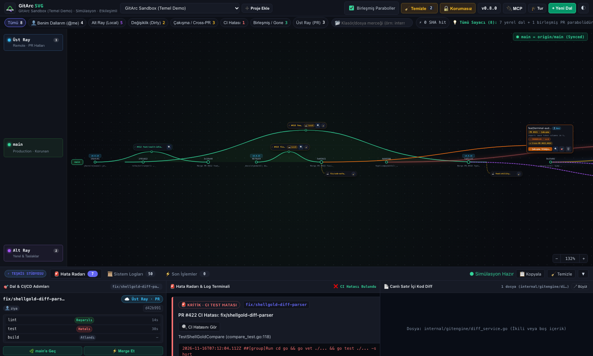
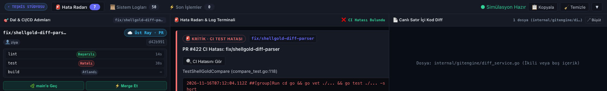
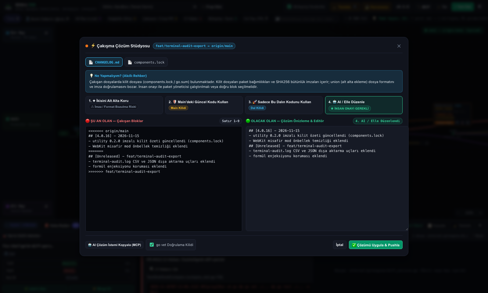
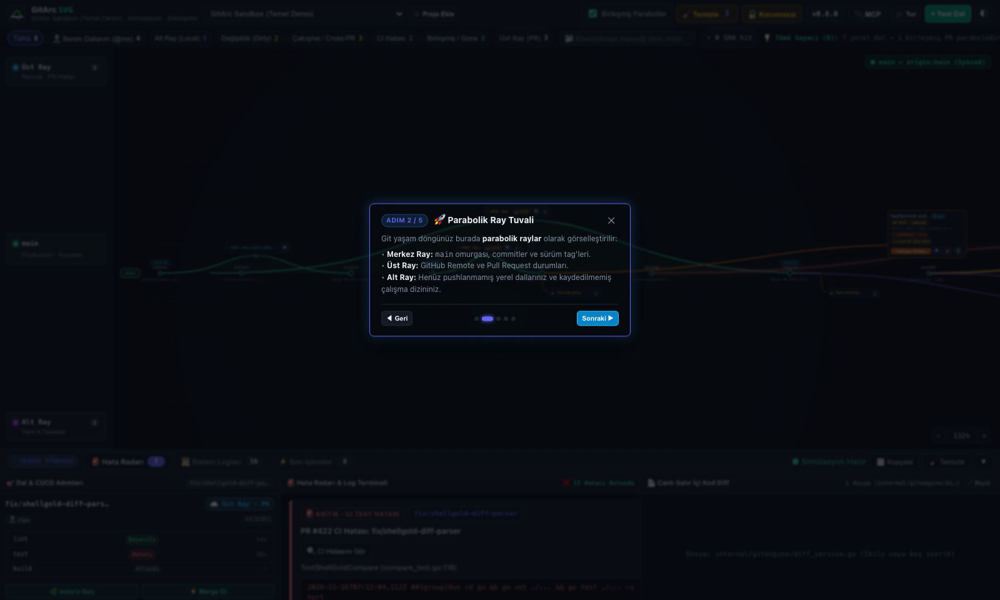

# GitArc — Parabolik Git & PR Yaşam Döngüsü Kokpiti

**GitArc**, düz `git log` ağaçları yerine Git ve GitHub yaşam döngüsünü **parabolik ray topolojisiyle** gösteren, sıfır bağımlılıklı bir yerel kokpittir. Yerel dallarınızı (`HEAD`, uncommitted dosyalar, `origin` farkları) ile GitHub Remote, Pull Request, Review ve GitHub Actions CI durumlarını tek bir SVG tuvalinde birleştirir. [KeyLab (`sshpocket`)](https://github.com/syhgorath/keylab) tasarım ve güvenlik DNA'sını paylaşan bağımsız bir kardeş projedir.



## Parabolik metafor

| Bölge | Anlamı |
| :--- | :--- |
| **Merkez ray (`main`)** | Commit düğümleri, etiketler ve `origin/main ↑ / ↓` senkron farkı |
| **Üst yarı-küre** | Uzak dala pushlanmış, açık Pull Request ve CI durumu taşıyan dallar |
| **Alt yarı-küre** | Henüz pushlanmamış yerel dallar ve kirli çalışma ağacı (`wip/working-tree`) |
| **Kapalı yeşil yay** | `main`'e geri dönen, birleşmiş dallar |
| **Renkli yaylar** | Kırmızı: CI hatası · Turuncu: çakışma · Sarı nabız: CI çalışıyor |

Dallar kalabalıklaştıkça şerit sayısı sınırsız artar, omurga düğümleri açılır ve dış yaylar iç yayları kapsayacak biçimde çizilir.

## Öne çıkanlar

### Hata Radarı ve alt çekmece
CI hatası, çakışma, Cross-PR dosya çarpışması ve `origin: gone` kalıntıları tam genişlikte kartlarla listelenir. Kartlar etkilenen dosyaları, ayıklanmış CI hata logunu, kopyalanabilir terminal komutunu ve tek tıkla eylemleri (`CI Hatasını Gör`, `Çakışma Stüdyosu`, `Dalı Temizle`) içerir.



### Çakışma Çözüm Stüdyosu
Çakışan dosyalar sol tarafta (**şu an olan**) gerçek 3 yollu `git merge-file` blokları, sağ tarafta (**olacak olan**) canlı önizleme olarak yan yana gösterilir. Dosya türüne göre `★ ÖNERİLEN` strateji sunulur: `union`, `ours`, `theirs` veya elle/AI düzenleme. Çözüm, çalışma ağacınıza dokunmadan geçici bir `git worktree` içinde uygulanır; `go.mod` varsa `go vet ./...` geçmeden pushlanmaz.



### Etkileşimli tur
`🎓 Tur` düğmesi, kokpitin bölümlerini adım adım tanıtan 5 adımlı bir rehber açar.



### Diğer yetenekler
- **Hata geçirmezlik:** Ön koşulları kullanıcıya yüklemez, güvenli olduğunda kendisi çözer (silinecek dal aktifse `main`'e geçer, kirli ağaçla `Push & PR` basılırsa önce commit atar). Boş dalı GitHub'a göndermeden önce yerelde durdurur.
- **Taze yerel dal ayrımı:** `main`'e göre commit'i olmayan yeni dallar yanlışlıkla "silinmiş kalıntı" sayılmaz, `🌱 Yeni Yerel Dal` olarak gösterilir.
- **Konsolsuz commit & PR:** Kirli çalışma ağacını yeni dala alıp commit mesajı, PR başlığı ve açıklamasıyla tek tıkla push + PR açar.
- **CI çalışırken merge kuyruğu:** `CI: RUNNING` iken Merge'e basılırsa dal kuyruğa alınır, CI geçince otomatik birleşir, başarısız olursa iptal edilir.
- **Merge stratejileri:** `Merge`, `Squash`, `Rebase` ve `--auto` (Merge Queue).
- **PR başlık/açıklama ve son commit mesajı düzenleme** (`gh pr edit`, `git commit --amend --only`).
- **Mega-repo ölçekleme:** SHA-bazlı değerlendirme önbelleği, 40 dallık sıralı pencere, ters indeksli Cross-PR motoru, `👤 Benim Dallarım`, klasör/dosya merceği.
- **Takım sunucusu modu (`-team`):** Paylaşılan `HEAD`'i değiştiren işlemleri kilitler; izole worktree çözümü ve PR merge çalışmaya devam eder.
- **Çoklu proje:** Yerel Git depolarını ekleyip üst çubuktan seçebilirsiniz (`~/.gitarc/projects.json`).
- **Sunucusuz çalışma:** `web/index.html` doğrudan tarayıcıda açılırsa yerleşik `LocalFallbackEngine` ile simülasyon modunda çalışır.

## Hızlı başlangıç

Gereksinimler: Go (sürüm `go.mod` içinde), `git`. GitHub özellikleri (PR, CI, branch protection) için [`gh` CLI](https://cli.github.com/) kurulu ve oturum açılmış olmalıdır; `gh` yoksa (veya uzak depo GitHub değilse) PR/CI/koruma bilgisi gösterilmez, yerel Git özellikleri çalışmaya devam eder.

```bash
# Derle ve bulunduğun Git deposunu canlı modda aç
go build -o gitarc .
./gitarc

# Demo simülasyon modunda aç (hiçbir depoya dokunmaz)
./gitarc -repo sim

# Belirli bir yerel depoyu aç
./gitarc -repo /yol/depo
```

| Bayrak | Varsayılan | Açıklama |
| :--- | :--- | :--- |
| `-addr` | `127.0.0.1:7432` | Dinlenecek adres |
| `-repo` | `.` | Açılacak depo (`sim` demo modu) |
| `-demo` | `false` | Örnek playground deposuyla başlat |
| `-open` | `true` | Tarayıcıyı otomatik aç |
| `-team` | `false` | Paylaşılan sunucu koruması |
| `-mcp` | `false` | stdio MCP sunucusu olarak çalış |

Demo depolar: **GitArc Sandbox** (temel) ve **MegaCorp Platform** (50 geliştirici, 4 ana hat, kurumsal senaryo). Üst çubuktaki depo seçiciden geçiş yapabilirsiniz.

## MCP entegrasyonu (AI ajanları)

`./gitarc -mcp -repo .` komutu, sıfır bağımlılıklı bir `stdio` JSON-RPC 2.0 sunucusu açar (Claude Code, Cursor, Antigravity vb.):

| Araç | Ne yapar |
| :--- | :--- |
| `gitarc_status` | Topoloji, açık/birleşmiş dallar ve teşhis özeti |
| `gitarc_check_conflicts` | `git merge-tree` çakışma ve Cross-PR kesişim raporu |
| `gitarc_ci_failure_digest` | Gürültüsüz CI hata özeti ve yerel repro komutu |
| `gitarc_sync_main` | Çalışma dizinini bozmadan `origin/main` eşitleme |
| `gitarc_resolve_conflict` | İzole worktree içinde doğrulamalı çakışma çözümü |

Ayrıntılı mimari şartname için [docs/PLAN.md](docs/PLAN.md) belgesine bakın.

## Güvenlik modeli

- Yalnızca `127.0.0.1` dinler; `Host` başlığı doğrulanır (DNS rebinding koruması).
- `HttpOnly; SameSite=Strict` oturum çerezi, `POST` isteklerinde `X-Requested-With: gitarc` ve `Origin` denetimi (CSRF).
- Katı `Content-Security-Policy` (`style-src-attr 'none'`): arayüzde satır içi `style` yoktur.
- Dal adları ve kimlikler girdi doğrulamasından geçer; secret desenli dosyalar ve `git add -A` varsayılan olarak engellenir (`.gitarc` ile genişletilebilir).
- Çakışma algılama ve çözümü, aktif çalışma ağacındaki kirli dosyalara asla dokunmaz.

## Geliştirme ve test

```bash
go vet ./...
go test -count=1 -race -cover ./...
go build -o gitarc .
for f in web/*.js web/modules/*.js; do node --check "$f"; done
```

- Yalnızca Go standart kütüphanesi kullanılır; `web/` dizini `//go:embed` ile ikiliye gömülür (arayüz değişikliğinden sonra yeniden derleyin).
- Testler gerçek geçici Git depoları, sahte bir `gh` ikilisi ve yerel bare uzak depolarla çalışır; ağa veya gerçek GitHub hesabına dokunmaz, `~/.gitarc` dizinini de kirletmez.
- `canvas.js` yerleşim mantığı için Node'un yerleşik test koşucusuyla yazılmış testler (`tests/js/`) `go test` içinden de çalışır (node kuruluysa).

Daha fazlası: [HANDOVER.md](HANDOVER.md) (teknik devir teslim ve mimari harita), [AGENTS.md](AGENTS.md) (çalışma kuralları), [CHANGELOG.md](CHANGELOG.md), [docs/PLAN.md](docs/PLAN.md).
